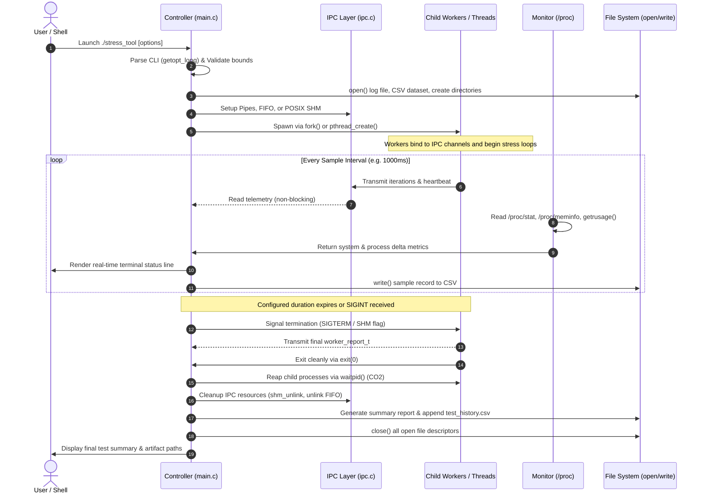
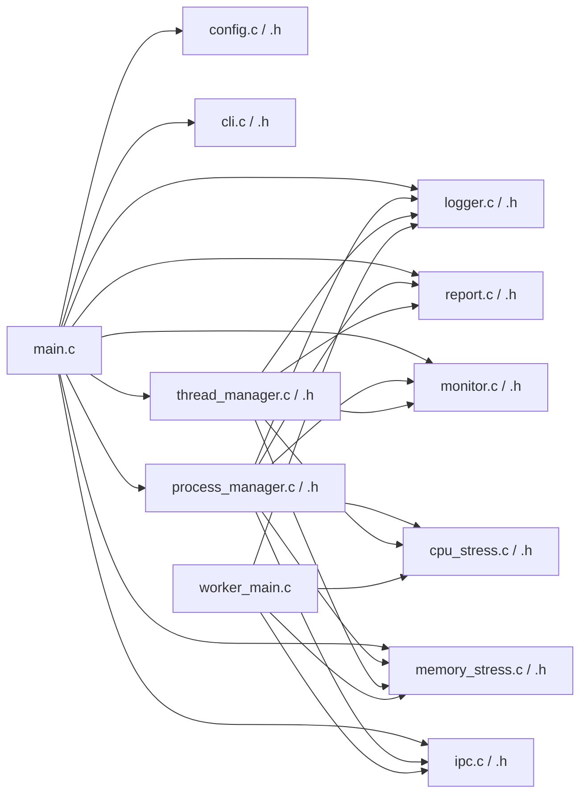

# System Architecture & Technical Design Document
## CPU and Memory Stress Testing Tool — OSSP Hackathon

---

## 1. System Overview
The **CPU and Memory Stress Testing Tool** is a high-performance, command-line systems engineering utility written in C for Linux. It generates configurable, safe, and controlled computational workloads across multi-core processors and system virtual memory, providing real-time telemetry and structured persistent reports.

The architecture is explicitly designed around the six Operating Systems & System Programming (OSSP) Course Outcomes (CO1–CO6).

---

## 2. High-Level System Architecture Diagram

```mermaid
graph TD
    User["CLI User / Terminal Shell"] -->|Command Line Arguments| CLI["CLI Parser (cli.c)"]
    CLI --> Config["Configuration & Safety Validator (config.c)"]
    Config --> Controller["Main Controller Orchestrator (main.c)"]

    subgraph "Workload Engines"
        Controller -->|Process Mode (CO2)| PM["Process Manager (process_manager.c)"]
        Controller -->|Thread Mode (CO6)| TM["Thread Manager (thread_manager.c)"]
        Controller -->|COW / VM Demo (CO4)| VM["Virtual Memory Engine (memory_stress.c)"]
    end

    subgraph "IPC & Synchronization Layer (CO3 / CO6)"
        PM -->|Anonymous Pipes| Pipes["Worker Pipes [pipe()]"]
        PM -->|Named Pipe| FIFO["FIFO [/tmp/stress_tool_fifo]"]
        PM -->|POSIX SHM| SHM["Shared Memory [/dev/shm]"]
        TM -->|Pthread Primitives| Sync["Mutex / CondVar / Semaphores"]
    end

    subgraph "Execution Workers"
        PM -->|fork() [In-Process]| ChildWorkers["Child Worker Processes"]
        PM -->|fork() + execv()| ExtWorker["External Worker Binary (stress_worker)"]
        TM -->|pthread_create()| Pthreads["Worker Pthreads"]
        ChildWorkers --> Kernels["CPU Kernels & Memory Access Loops"]
        ExtWorker --> Kernels
        Pthreads --> Kernels
    end

    subgraph "Resource Monitoring & Telemetry (CO1 / CO4)"
        ProcStat["/proc/stat (CPU Jiffies)"] --> Monitor["Resource Monitor (monitor.c)"]
        ProcMem["/proc/meminfo (RAM stats)"] --> Monitor
        ProcSelf["/proc/self/status & getrusage()"] --> Monitor
        Monitor --> LiveTerm["ANSI Live Terminal Status Line"]
    end

    subgraph "File System & Artifact Generation (CO5)"
        Controller --> Logger["Low-Level Syscall Logger (logger.c)"]
        Controller --> Reporter["Report Generator (report.c)"]
        Reporter --> CSV["CSV Time-Series Dataset"]
        Reporter --> Summary["Human-Readable Summary (.txt)"]
        Reporter --> Ledger["Historical Test Ledger (test_history.csv)"]
        Logger --> LogFile["Low-Level Execution Log (.log)"]
    end
```

---

## 3. Execution Flow Diagram



---

## 4. Module Dependency Diagram



---

## 5. Data Flow Diagram: Worker Telemetry to File System

```mermaid
flowchart TD
    subgraph Workers["Worker Subsystems (Processes / Threads)"]
        W1["Worker 0"]
        W2["Worker 1"]
        WN["Worker N"]
    end

    subgraph Channels["IPC Transports"]
        PipeChan["Anonymous Pipe File Descriptors (O_NONBLOCK)"]
        FIFOChan["Named Pipe / FIFO (/tmp/stress_tool_fifo_PID)"]
        SHMChan["POSIX Shared Memory Buffer (/stress_tool_shm_PID)"]
    end

    W1 & W2 & WN -->|write(worker_report_t)| PipeChan
    W1 & W2 & WN -->|write(worker_report_t)| FIFOChan
    W1 & W2 & WN -->|Lockless Direct Write| SHMChan

    subgraph Ingestion["Controller Ingestion & Metrics Fusion"]
        Collector["IPC Ingestion Engine"]
        KernelMonitor["/proc Resource Sampling Engine"]
    end

    PipeChan & FIFOChan & SHMChan --> Collector
    KernelMonitor -->|SysCPU, SysMem, AppRSS, MinFlt| Fusion["Telemetry Aggregator"]
    Collector -->|Iterations, UserTime, SysTime| Fusion

    subgraph OutputSinks["Low-Level File System Output Sinks"]
        Terminal["Live ANSI Terminal Dashboard"]
        CSVFile["Time-Series Dataset (stress_*.csv)"]
        LogFile["Raw Syscall Log (stress_*.log)"]
        SummaryFile["Human-Readable Summary (stress_*_summary.txt)"]
        HistoryFile["Historical Test Ledger (test_history.csv)"]
    end

    Fusion --> Terminal
    Fusion -->|write()| CSVFile
    Fusion -->|write()| LogFile
    Fusion -->|write() + lseek()| SummaryFile
    Fusion -->|write() [Append]| HistoryFile
```

---

## 6. Key Design Decisions and Rationale

1. **Pure C with POSIX Standards**:
   - Zero external third-party library dependencies (only standard C library, `libpthread`, `librt`, `libm`).
   - Ensures native portability across all Linux distributions (Ubuntu, Debian, Fedora, Arch, Alpine).

2. **Strict User Mode vs. Kernel Mode Segregation**:
   - Workload algorithms run strictly in user mode (`ring 3`).
   - System transitions into kernel mode (`ring 0`) exclusively via vetted system calls:
     - Process management: `sys_clone` (`fork`), `sys_execve`, `sys_wait4` (`waitpid`), `sys_exit_group`.
     - Memory management: `sys_mmap`, `sys_munmap`, `sys_brk`.
     - File systems: `sys_openat`, `sys_write`, `sys_read`, `sys_lseek`, `sys_close`, `sys_mkdir`.
     - IPC: `sys_pipe2`, `sys_mknodat` (`mkfifo`), `sys_rt_sigaction`, `sys_kill`.

3. **Multi-Channel IPC Architecture**:
   - Supports anonymous pipes for standard parent-child streams.
   - Supports named pipes (FIFOs) for filesystem-based channel rendezvous.
   - Supports POSIX shared memory for ultra-low latency real-time telemetry.

4. **Guaranteed Cleanup and Safety Rails**:
   - Hard memory ceiling enforced dynamically against `/proc/meminfo` (never exceeds 80% of available RAM).
   - Signal traps (`SIGINT`, `SIGTERM`, `SIGALRM`) trigger child reaping and resource unlinking, preventing zombie processes, orphaned children, or leaked SHM segments in `/dev/shm`.
